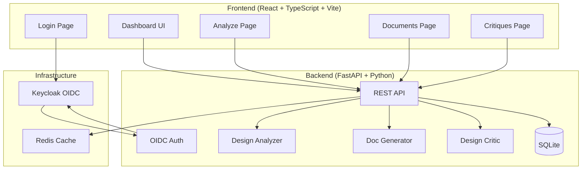

# README for axiom-hub-ryan-vo — Ryan Vo

> Work in progress. This checkpoint may be incomplete or fail tests. See PLAN.md and STATUS.md before use.


# axiom-hub-ryan-vo

The design language that makes your AI harness better at design.

**Author**: Ryan Vo (ryandtvo@gmail.com) | AI & Machine Learning

## Overview

axiom-hub-ryan-vo is an AI/ML developer tool that analyzes frontend codebases to extract design systems, generate DESIGN.md documentation, and critique designs against a quality floor. It provides three complete workflows:

1. **Design System Analysis** - Extract type scale, color palette, spacing, and component patterns from frontend codebases
2. **DESIGN.md Generation** - Create standardized design system documentation from analysis results
3. **Design Critique** - Evaluate designs against craft floor rules with actionable findings

All core analysis runs deterministically offline without requiring LLM keys. LLM explanations are opt-in, labeled advisory, and grounded in actual records.

## Architecture



## Features

- **Deterministic Offline Core**: Design analysis runs without any LLM API keys
- **OIDC Authentication**: Secure Keycloak integration with PKCE, roles (admin/operator/analyst/viewer)
- **Three Complete Workflows**:
  - Analyze: Scan codebases for design tokens (colors, spacing, typography, components)
  - Generate: Create DESIGN.md files with 8-section standardized format
  - Critique: Evaluate against craft floor rules (cramped-padding, hard-offset-shadow, etc.)
- **Advisory LLM Explanations**: Opt-in, clearly labeled, never fabricated
- **Responsive Professional UI**: React + TypeScript with loading/error/empty states
- **Docker Deployment**: Multi-container with persistent volumes
- **Comprehensive Tests**: 12+ backend tests, 3+ frontend tests

## Quick Start

### Prerequisites

- Docker and Docker Compose
- Node.js 24+ (for local frontend development)
- Python 3.12+ (for local backend development)

### Using Docker Compose (Recommended)

1. Clone the repository:
   ```bash
   git clone https://github.com/A220man/axiom-hub-ryan-vo.git
   cd axiom-hub-ryan-vo
   ```

2. Copy environment template and configure:
   ```bash
   cp .env.example .env
   # Edit .env with your settings (SECRET_KEY, LLM_API_KEY, etc.)
   ```

3. Start all services:
   ```bash
   docker compose up -d
   ```

4. Access the application:
   - Frontend: http://localhost:5173
   - Backend API: http://localhost:8000
   - API Docs: http://localhost:8000/docs
   - Keycloak Admin: http://localhost:8080 (admin/admin)

### Local Development

#### Backend

```bash
cd backend
python -m venv .venv
source .venv/bin/activate
pip install -r requirements.txt
cp ../.env.example .env
# Edit .env
uvicorn app.main:app --reload --host 0.0.0.0 --port 8000
```

#### Frontend

```bash
cd frontend
npm install
npm run dev
```

#### Keycloak

```bash
docker run -p 8080:8080 \
  -e KEYCLOAK_ADMIN=admin \
  -e KEYCLOAK_ADMIN_PASSWORD=admin \
  -v ./keycloak/realm-export.json:/opt/keycloak/data/import/realm-export.json:ro \
  quay.io/keycloak/keycloak:24.0 start-dev --import-realm
```

## Running Tests

### Backend Tests

```bash
cd backend
source .venv/bin/activate
PYTHONPATH=backend python -m pytest tests -v
```

### Frontend Tests

```bash
cd frontend
npm test
```

### Full CI Pipeline

```bash
# Runs backend tests, frontend typecheck/build/tests, and Docker builds
docker compose -f docker-compose.ci.yml up --abort-on-container-exit
```

## API Reference

### Authentication

- `GET /api/v1/auth/config` - Get OIDC configuration for PKCE flow
- `GET /api/v1/auth/login` - Initiate OIDC authorization code flow
- `POST /api/v1/auth/callback` - Exchange authorization code for tokens
- `POST /api/v1/auth/refresh` - Refresh access token
- `GET /api/v1/auth/me` - Get current user info
- `POST /api/v1/auth/logout` - Logout

### Design Analysis

- `POST /api/v1/analyze/design-system` - Analyze a frontend codebase
- `GET /api/v1/analyze/design-system` - List analyses (paginated)
- `GET /api/v1/analyze/design-system/{id}` - Get analysis by ID
- `DELETE /api/v1/analyze/design-system/{id}` - Delete analysis

### Design Document Generation

- `POST /api/v1/generate/design-doc` - Generate DESIGN.md from analysis or custom content
- `GET /api/v1/generate/design-doc` - List documents (paginated)
- `GET /api/v1/generate/design-doc/{id}` - Get document by ID
- `GET /api/v1/generate/design-doc/{id}/download` - Download document as .md file
- `DELETE /api/v1/generate/design-doc/{id}` - Delete document

### Design Critique

- `POST /api/v1/critique/design` - Critique a design against craft floor rules
- `GET /api/v1/critique/design` - List critiques (paginated)
- `GET /api/v1/critique/design/{id}` - Get critique by ID
- `DELETE /api/v1/critique/design/{id}` - Delete critique

## Security

- **Authentication**: OIDC authorization code flow with PKCE via Keycloak
- **Authorization**: Role-based access control (admin, operator, analyst, viewer)
- **Tokens**: JWT with HttpOnly cookies for sessions, bearer tokens for API
- **Secrets**: All credentials via environment variables, never committed
- **CORS**: Configurable origins
- **Rate Limiting**: Recommended via reverse proxy (nginx/Traefik)

## Provider Configuration

| Provider | LLM_PROVIDER | LLM_MODEL | LLM_BASE_URL |
|----------|--------------|-----------|--------------|
| OpenAI | openai-compatible | gpt-4o-mini | https://api.openai.com/v1 |
| Anthropic | anthropic | claude-3-haiku | https://api.anthropic.com |
| Gemini | gemini | gemini-1.5-flash | https://generativelanguage.googleapis.com |
| Ollama | ollama | llama3.1 | http://localhost:11434/v1 |
| LiteLLM | openai-compatible | * | http://localhost:4000 |
| OpenRouter | openai-compatible | * | https://openrouter.ai/api/v1 |

## SSO/SAML Setup

Keycloak supports upstream SAML IdPs through identity brokering:

1. In Keycloak Admin Console, go to **Identity Providers** → **Add Provider** → **SAML v2.0**
2. Configure SAML settings from your IdP (entity ID, SSO URL, certificates)
3. Map SAML attributes to Keycloak user attributes
4. Enable the identity provider for the axiom realm

## Backup & Restore

### Database Backup (SQLite)

```bash
# Backup
docker compose exec backend cp /app/data/axiom.db /app/data/axiom.db.backup.$(date +%Y%m%d)

# Restore
docker compose exec backend cp /app/data/axiom.db.backup.YYYYMMDD /app/data/axiom.db
```

### Keycloak Backup

```bash
# Export realm
docker compose exec keycloak /opt/keycloak/bin/kc.sh export --dir /opt/keycloak/data/export --realm axiom
```

## TLS Reverse Proxy (Production)

For production, deploy behind a TLS-terminating reverse proxy:

```nginx
server {
    listen 443 ssl http2;
    server_name your-domain.com;

    ssl_certificate /path/to/cert.pem;
    ssl_certificate_key /path/to/key.pem;

    location / {
        proxy_pass http://frontend:80;
        proxy_set_header Host $host;
        proxy_set_header X-Real-IP $remote_addr;
        proxy_set_header X-Forwarded-For $proxy_add_x_forwarded_for;
        proxy_set_header X-Forwarded-Proto $scheme;
    }

    location /api/ {
        proxy_pass http://backend:8000;
        proxy_set_header Host $host;
        proxy_set_header X-Real-IP $remote_addr;
        proxy_set_header X-Forwarded-For $proxy_add_x_forwarded_for;
        proxy_set_header X-Forwarded-Proto $scheme;
    }
}
```

## AI/ML Evaluation

The design analyzer uses deterministic algorithms for:
- CSS custom property extraction (colors, spacing, typography)
- Tailwind class pattern recognition
- Component file detection and styling approach classification
- Type scale normalization and validation

No benchmark numbers are claimed as the system is deterministic by design. The critique engine implements craft floor rules from the impeccable project's reference materials.

## Limitations

- SQLite database (single-writer) - use PostgreSQL for high-concurrency production
- Local file system analysis only - no remote repository scanning
- LLM explanations require valid API keys and are advisory only
- Keycloak runs in dev mode by default - configure for production
- No built-in CI/CD deployment - requires external orchestration

## License

MIT License - Copyright (c) 2024 Ryan Vo <ryandtvo@gmail.com>

See [LICENSE](LICENSE) for details.